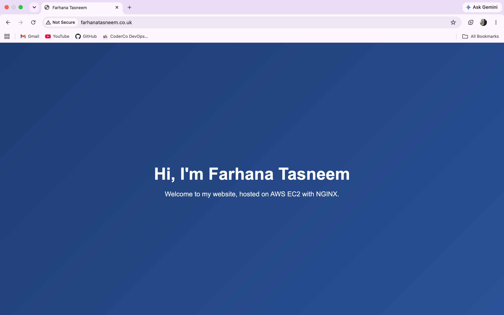

# 🌐 Hosting a Website on AWS EC2 with NGINX & Cloudflare

A step-by-step guide to launching an **NGINX web server on Amazon EC2** and connecting it to a **custom domain bought on Cloudflare**.

By the end, the site is live on my own domain, powered by AWS and NGINX.

---

## 🛠️ Tools Used


## 🗺️ How It Works

```
User's browser  ──►  Cloudflare DNS  ──►  EC2 instance (public IP)  ──►  NGINX  ──►  Web page
```

---

## Step 1: Buy a Domain on Cloudflare

1. Go to [cloudflare.com](https://www.cloudflare.com).
2. Search for the domain you want (e.g. `farhanatasneem.co.uk`) and buy it.
3. Cloudflare manages the DNS for you automatically, which makes Step 5 easier.

## Step 2: Launch an EC2 Instance

In the AWS Console, search **EC2** → **Launch instance**.

**Instance settings**

| Setting | Value |
|---------|-------|
| Name | `nginx-server` |
| AMI | Amazon Linux 2023 |
| Instance type | `t3.micro` |
| Key pair | Create a new one (or choose an existing one) and keep the `.pem` file safe |

**Security group (inbound rules)**

| Type | Port | Source |
|------|------|--------|
| SSH | 22 | My IP |
| HTTP | 80 | 0.0.0.0/0 |
| HTTPS | 443 | 0.0.0.0/0 |

> 🔒 Setting SSH to **My IP** means only you can connect to the server.

Click **Launch instance**, then copy the **Public IPv4 address**. You'll need it later.

## Step 3: Connect via SSH

Replace the placeholders with your key path and public IP:

```bash
ssh -i ~/path/to/key.pem ec2-user@<EC2_PUBLIC_IP>
```

## Step 4: Install and Start NGINX

```bash
sudo yum update -y
sudo yum install -y nginx
sudo systemctl start nginx
sudo systemctl enable nginx
sudo systemctl status nginx
```

You should see **`active (running)`** in green.

✅ **Test it:** open `http://<EC2_PUBLIC_IP>` in your browser. The NGINX welcome page should appear.

## Step 5: Point Your Domain to EC2 (Cloudflare DNS)

In Cloudflare, go to **DNS** → **Records** → **Add record**:

| Field | Value |
|-------|-------|
| Type | `A` |
| Name | `nginx` (creates `nginx.yourdomain.co.uk`) |
| IPv4 address | `<EC2_PUBLIC_IP>` |
| Proxy status | DNS only (grey cloud) for testing |
| TTL | Auto |

Click **Save**.

## Step 6: Check the DNS Is Live

From your local terminal, run either:

```bash
nslookup nginx.yourdomain.co.uk
```

```bash
dig +short nginx.yourdomain.co.uk
```

Both should return your EC2 public IP.

✅ **Test it:** visit `http://nginx.yourdomain.co.uk`. The NGINX page should load.

---

## ✨ Bonus: Customise the Web Page

Connect to your instance, then back up the default page:

```bash
cd /usr/share/nginx/html
sudo cp index.html index.html.bak
```

Edit the page:

```bash
sudo nano index.html
```

Delete the default content, paste in your own HTML, then save (**Ctrl + O**, **Enter**, **Ctrl + X**).

Reload NGINX and refresh your browser:

```bash
sudo systemctl reload nginx
```

🎉 Your custom page is now live on your domain!



---

## 📚 What I Learnt

- Launching and configuring an EC2 instance
- Using security groups to control traffic on different ports
- Connecting to a remote Linux server over SSH
- Installing and managing services with `systemctl`
- Creating DNS A records to point a domain to a server
- Testing DNS with `nslookup` and `dig`


