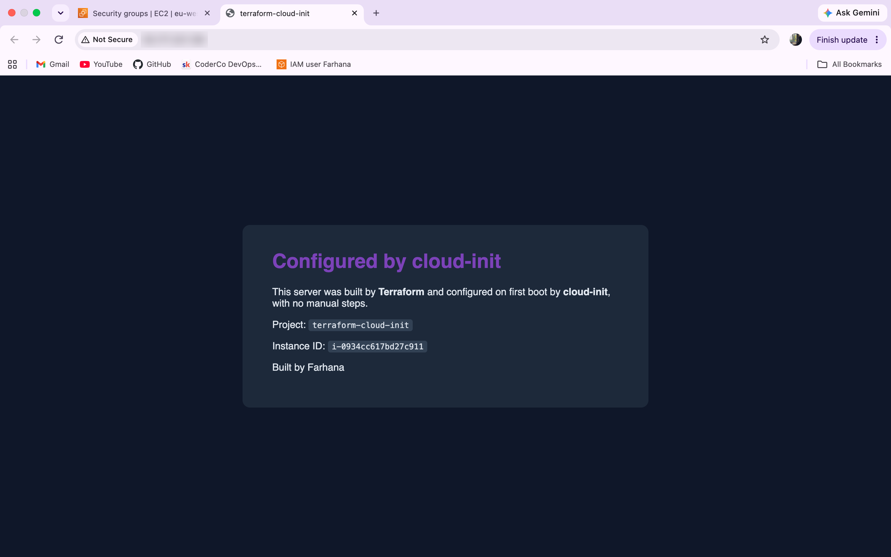
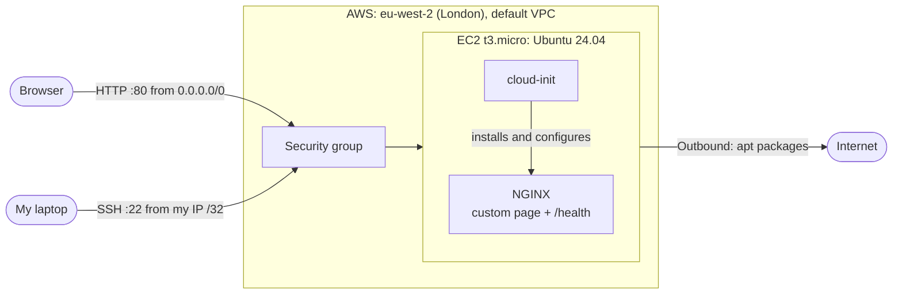
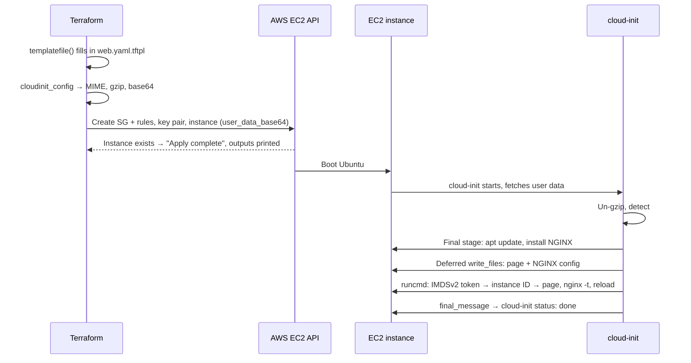
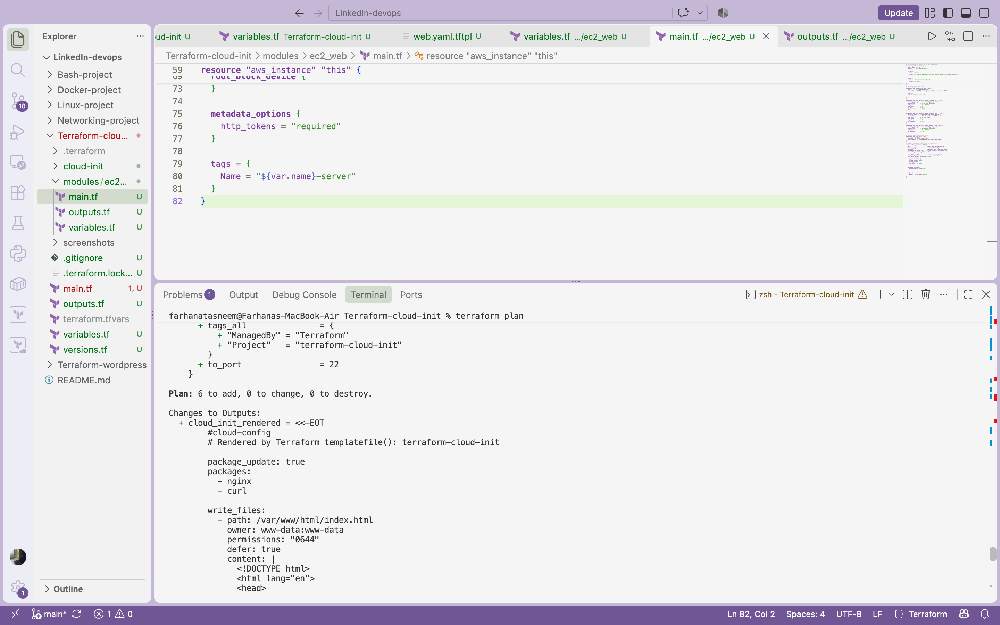
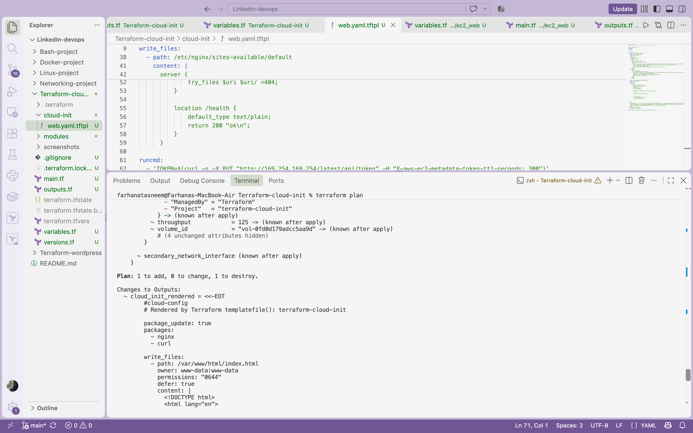
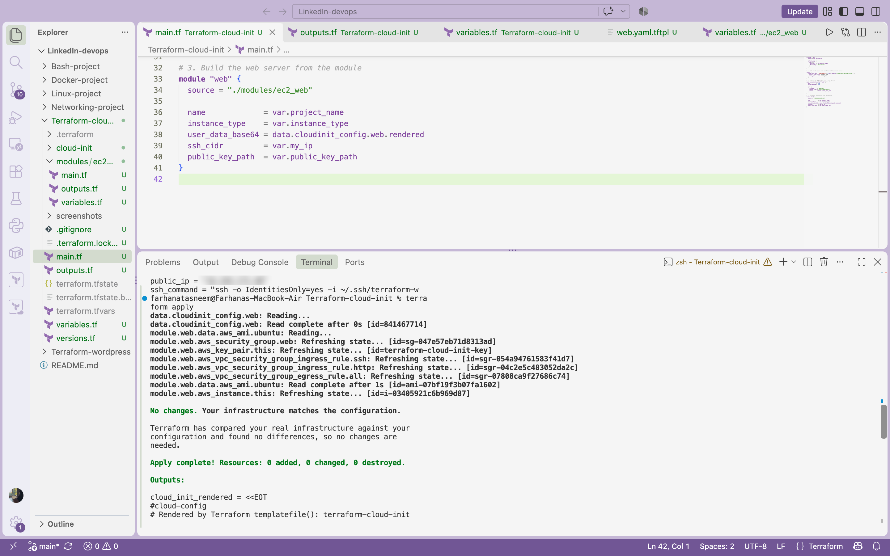
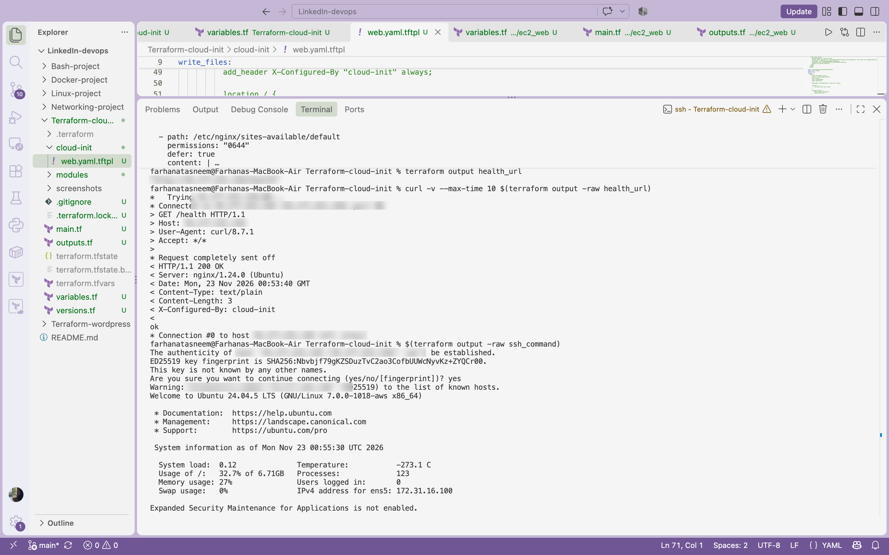
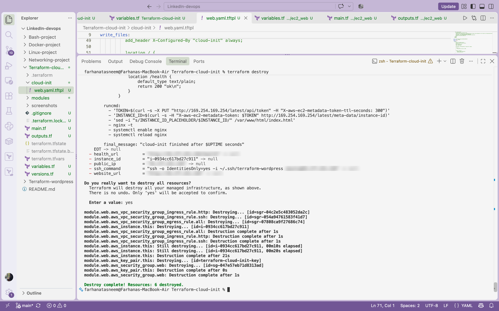
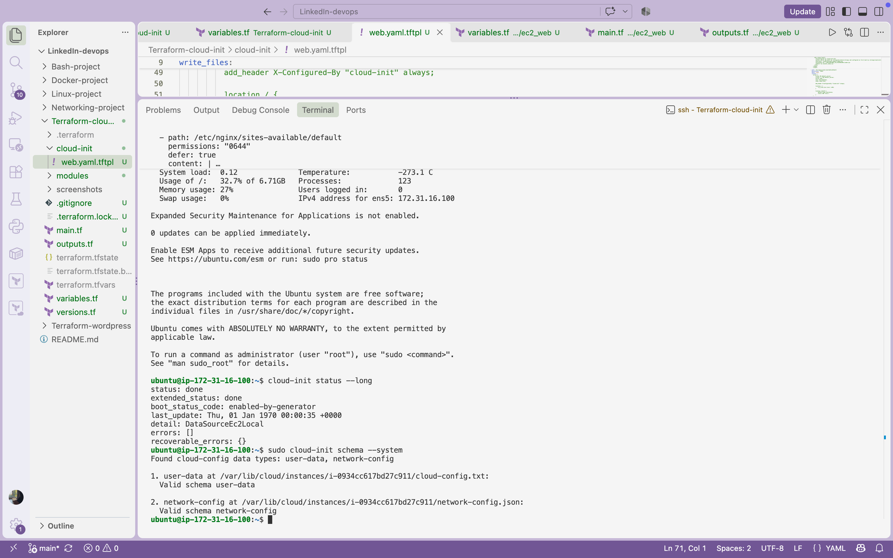

# EC2 Deployment with Cloud-Init and Terraform

**Terraform Assignment 2:** Terraform launches an EC2 instance and hands it a **cloud-init YAML file**. On first boot, cloud-init installs and configures **NGINX** and publishes a custom web page. The server comes online **fully configured, with no manual steps**.



---

## Contents

- [What the assignment asks for](#what-the-assignment-asks-for)
- [Key concepts](#key-concepts)
  - [What cloud-init is](#what-cloud-init-is)
  - [Cloud-init YAML vs a Bash script](#cloud-init-yaml-vs-a-bash-script)
  - [`user_data` vs `user_data_base64`](#user_data-vs-user_data_base64)
  - [Structuring Terraform with a module](#structuring-terraform-with-a-module)
- [Architecture](#architecture)
- [The workflow: from `terraform apply` to a configured server](#the-workflow-from-terraform-apply-to-a-configured-server)
- [Project structure](#project-structure)
- [Step-by-step: how I built it](#step-by-step-how-i-built-it)
- [Verifying cloud-init](#verifying-cloud-init)
- [Challenges and fixes](#challenges-and-fixes)
- [How to run it yourself](#how-to-run-it-yourself)
- [What I learnt](#what-i-learnt)
- [Future improvements](#future-improvements)

---

## What the assignment asks for

| Requirement | How I met it |
|---|---|
| Write a cloud-init YAML file | [`cloud-init/web.yaml.tftpl`](cloud-init/web.yaml.tftpl): a `#cloud-config` file using the `packages`, `write_files` and `runcmd` modules |
| Install and configure software on boot | NGINX is installed, given a custom server config, a custom page and a `/health` endpoint, then validated and reloaded |
| Pass cloud-init to EC2 through Terraform | Rendered with `templatefile()`, packaged by the `cloudinit_config` data source (MIME + gzip + base64) and passed via **`user_data_base64`** |
| Instance online fully configured, no manual steps | `terraform apply` → wait ~1 minute → the page and health check are live. No SSH or console needed. |
| Show how Terraform uses `user_data` / `user_data_base64` | [Explained below](#user_data-vs-user_data_base64), and I decoded the real value to prove what EC2 receives |
| Show how cloud-init automates configuration | [Explained below](#what-cloud-init-is), with `cloud-init status` and schema validation from the live server |
| Structure Terraform for clarity | A root module + a reusable **`ec2_web` child module**, with variables and outputs at both levels, a `versions.tf`, `default_tags` and input validation |

**How this differs from Assignment 1:** Assignment 1 used a **Bash script** as user data. This one uses **cloud-init's declarative YAML**, passes it **compressed and base64-encoded**, and splits the Terraform into a **module**.

---

## Key concepts

### What cloud-init is

**cloud-init** is the industry-standard tool for setting up a cloud server the first time it boots. It comes pre-installed on almost every cloud Linux image, including the Ubuntu 24.04 AMI used here.

When an EC2 instance starts, cloud-init:
1. **Fetches the user data** that Terraform supplied, from the EC2 instance metadata service
2. **Works out what kind of data it is**: gzip is detected and decompressed automatically; `#cloud-config` means "cloud-init YAML", and `#!/bin/bash` means "run as a script"
3. **Runs it in stages** as the machine boots:

| Stage | Roughly when | Examples of what runs |
|---|---|---|
| **local** | Very early, before networking | Find the data source (EC2), set up networking config |
| **network (init)** | Once networking is up | Normal `write_files`, SSH keys, hostname |
| **config** | Mid-boot | Timezone, locale, NTP |
| **final** | Last | **Install packages**, deferred `write_files`, **`runcmd`**, `final_message` |

4. **Logs everything** to `/var/log/cloud-init.log` (detailed) and `/var/log/cloud-init-output.log` (command output)
5. **Remembers it has run for this instance**, so it won't redo first-boot setup on a normal reboot. That's why changing the config needs a **new instance** (see `user_data_replace_on_change` below).

### Cloud-init YAML vs a Bash script

| | Bash script (Assignment 1) | Cloud-init YAML (this project) |
|---|---|---|
| Style | **Imperative**: *how*, step by step | **Declarative**: *what* the end state is |
| Installing packages | `apt-get update && apt-get install -y …` | `package_update: true` + `packages: [nginx]` |
| Writing files | `cat > file <<EOF`, `sed`, `chown`, `chmod` | `write_files:` with `path`, `content`, `owner` and `permissions` |
| Error handling | You add it yourself (`set -euo pipefail`) | Built in: each module reports success or failure in `cloud-init status` |
| Readability | Fine when short; hard to scan when long | Each section has one job |
| Validation | `bash -n` (syntax only) | `cloud-init schema` validates against cloud-init's schema |
| Escape hatch | Everything is a command | `runcmd:` for the few things modules can't do |

Cloud-init YAML fits best when most of the work is "install these packages and put these files in place", which is exactly this project.

### `user_data` vs `user_data_base64`

| Argument | What you give it | When to use it |
|---|---|---|
| **`user_data`** | Plain text (a script or YAML) | Simple, small, human-readable user data. Terraform base64-encodes it for the API for you. |
| **`user_data_base64`** | Data that's **already** base64-encoded | When the data isn't plain text, most commonly **gzip-compressed** or a **MIME multi-part** document |

- **Why base64?** The EC2 API requires user data to be sent base64-encoded: a way of representing any bytes, including binary ones, as safe text.
- **Why gzip?** EC2 user data has a **16 KB limit**. Compression gives a growing config plenty of headroom. Gzip output is binary, so it must be base64-encoded, which means `user_data_base64`.
- **Why MIME multi-part?** It labels each part with its type (`text/cloud-config`), and lets you combine several parts, for example a cloud-config **and** a shell script.

**How I produce it:** the `cloudinit_config` data source (HashiCorp's `cloudinit` provider) does all three steps:

```
cloud-init/web.yaml.tftpl
        │  templatefile()  →  fills in ${project_name}, ${owner_name}
        ▼
data "cloudinit_config" "web"   →  MIME multi-part → gzip → base64
        │  .rendered
        ▼
aws_instance.user_data_base64   →  EC2  →  cloud-init (un-gzips, reads #cloud-config)
```

In the plan, the value starts with **`H4sI`**, which is what the gzip "magic bytes" look like in base64. I decoded it to prove the layers:

```bash
echo 'data.cloudinit_config.web.rendered' | terraform console | tr -d '"' | base64 -d | gunzip
```
```
Content-Type: multipart/mixed; boundary="MIMEBOUNDARY"
...
Content-Type: text/cloud-config

#cloud-config
# Rendered by Terraform templatefile(): terraform-cloud-init
...
```

### Structuring Terraform with a module

A **module** is a folder of `.tf` files that work together. Every project is a **root module**. A **child module** is called from the root with a `module` block, much like a function: you pass inputs in and read outputs back.

| Layer | Holds | Role |
|---|---|---|
| **Root module** | Provider config, cloud-init rendering, the `module "web"` call, top-level variables and outputs | The "what": *this* deployment's settings |
| **`modules/ec2_web`** | AMI lookup, security group and rules, key pair, EC2 instance | The "how": a reusable "web server on EC2" building block |

**Benefits:**
- The **root stays short and readable**: you can see the whole deployment at a glance
- The **module is reusable**: two web servers would just be two `module` blocks
- **A clear contract**: the module only knows its inputs (`name`, `instance_type`, `user_data_base64`, `ssh_cidr` and `public_key_path`). It doesn't care what the cloud-init does.
- The module has **no provider block**. It inherits the root's AWS provider, region and `default_tags`.
- Resources inside it appear in plans as **`module.web.<resource>`**

---

## Architecture



---

## The workflow: from `terraform apply` to a configured server



**"Apply complete" isn't the same as "configured".** Terraform finishes when AWS says the instance exists. Cloud-init then keeps working inside it, which took about 35 seconds after boot for this config.

---

## Project structure

```
Terraform-cloud-init/
├── versions.tf                # Terraform + provider version constraints
├── main.tf                    # AWS provider, cloud-init rendering, module call
├── variables.tf               # Root inputs (with validation on my_ip)
├── outputs.tf                 # Root outputs (passed up from the module)
├── cloud-init/
│   └── web.yaml.tftpl         # The cloud-init YAML (a Terraform template)
├── modules/
│   └── ec2_web/
│       ├── main.tf            # AMI lookup, security group, key pair, instance
│       ├── variables.tf       # Module inputs
│       └── outputs.tf         # Module outputs
├── .gitignore
├── .terraform.lock.hcl        # Committed: locks the aws + cloudinit provider versions
├── screenshots/
└── README.md
```

**Kept out of Git** (by `.gitignore`): `terraform.tfvars` (my IP), `*.tfstate*` and `.terraform/`.

---

## Step-by-step: how I built it

### Step 1: Project setup

Created the folders and empty files, and copied my `.gitignore` from Assignment 1 **before** running any Terraform command, so state, variable values, plan files and keys could never be committed.

```bash
mkdir -p Terraform-cloud-init/cloud-init Terraform-cloud-init/modules/ec2_web Terraform-cloud-init/screenshots
cp ../Terraform-wordpress/.gitignore .
```

`git status -u` (the `-u` lists every untracked file individually) confirmed `terraform.tfvars` and `.terraform/` are ignored.

### Step 2: Versions and providers

`versions.tf` keeps all version pinning in one place:

```hcl
terraform {
  required_version = ">= 1.5.0"

  required_providers {
    aws = {
      source  = "hashicorp/aws"
      version = "~> 6.0"
    }
    cloudinit = {
      source  = "hashicorp/cloudinit"
      version = "~> 2.3"
    }
  }
}
```

`terraform init` installed **aws v6.73.0** and **cloudinit v2.4.1** (`~> 2.3` allows any 2.x from 2.3 up).

The provider uses **`default_tags`**, so every resource is tagged automatically:

```hcl
provider "aws" {
  region = var.aws_region

  default_tags {
    tags = {
      Project   = var.project_name
      ManagedBy = "Terraform"
    }
  }
}
```

### Step 3: The cloud-init YAML

[`cloud-init/web.yaml.tftpl`](cloud-init/web.yaml.tftpl) is a Terraform **template** (`.tftpl`) containing cloud-init YAML:

| Section | What it does | Why |
|---|---|---|
| `#cloud-config` | **Must** be line 1 | Tells cloud-init this is YAML config, not a script |
| `package_update` + `packages` | `apt update`, install `nginx` and `curl` | Declarative package install, no Bash |
| `write_files` (custom page) | Writes `/var/www/html/index.html` owned by `www-data` | The page visitors see. `${project_name}` and `${owner_name}` are filled in by Terraform. |
| `write_files` (NGINX config) | Replaces `/etc/nginx/sites-available/default` | Adds a `/health` endpoint and an `X-Configured-By: cloud-init` header |
| `defer: true` on both files | Writes them in the **final** stage, **after** packages are installed | Otherwise installing NGINX could overwrite them |
| `runcmd` | Gets an **IMDSv2** token, fetches the instance ID, puts it on the page, then `nginx -t` and `systemctl reload nginx` | The only steps that need commands. The reload makes NGINX use the new config. |
| `final_message` | `cloud-init finished after $UPTIME seconds` | An easy-to-spot end marker in the log |

**Template gotcha:** in a `.tftpl` file, `${...}` belongs to **Terraform**. Shell and NGINX variables written **without** braces (`$TOKEN`, `$uri`, `$UPTIME`) pass through untouched. With braces, they'd need escaping as `$${...}`.

**YAML gotcha (it bit me, see [Challenges](#challenges-and-fixes)):** a `: ` (colon + space) inside an unquoted list item makes YAML read it as a key/value pair. The `runcmd` lines containing HTTP headers are wrapped in **single quotes**:

```yaml
runcmd:
  - 'TOKEN=$(curl -s -X PUT "http://169.254.169.254/latest/api/token" -H "X-aws-ec2-metadata-token-ttl-seconds: 300")'
  - 'INSTANCE_ID=$(curl -s -H "X-aws-ec2-metadata-token: $TOKEN" http://169.254.169.254/latest/meta-data/instance-id)'
  - 'sed -i "s/INSTANCE_ID_PLACEHOLDER/$INSTANCE_ID/" /var/www/html/index.html'
  - nginx -t
  - systemctl enable nginx
  - systemctl reload nginx
```

### Step 4: The `ec2_web` module

[`modules/ec2_web/`](modules/ec2_web/) contains everything needed for "a web server on EC2":

- **`data "aws_ami" "ubuntu"`**: the latest official Ubuntu 24.04 image, restricted to Canonical's owner ID (`099720109477`) so a look-alike AMI can't be used
- **Security group** with **separate rule resources**: HTTP 80 from `0.0.0.0/0`, SSH 22 from `var.ssh_cidr` only, and an explicit all-outbound egress rule (Terraform removes AWS's default one)
- **`aws_key_pair`**: uploads only my **public** key, generated locally, so the private key never enters Terraform state
- **`aws_instance`**:

```hcl
  user_data_base64            = var.user_data_base64
  user_data_replace_on_change = true

  root_block_device {
    volume_type = "gp3"
    volume_size = 8
    encrypted   = true
  }

  metadata_options {
    http_tokens = "required"   # IMDSv2
  }
```

- **`user_data_replace_on_change = true`**: because cloud-init only runs on first boot, a changed config **replaces** the instance. Without it, a fix would never take effect. (This saved me, see Challenges.)
- **IMDSv2 required**: the `runcmd` uses a session token to read the metadata service, which also proves IMDSv2 works
- **Encrypted gp3 disk**

Module outputs: `instance_id`, `public_ip`, `public_dns` and `security_group_id`.

### Step 5: The root module

[`main.tf`](main.tf) renders the cloud-init and calls the module:

```hcl
locals {
  cloud_init_yaml = templatefile("${path.module}/cloud-init/web.yaml.tftpl", {
    project_name = var.project_name
    owner_name   = var.owner_name
  })
}

data "cloudinit_config" "web" {
  gzip          = true
  base64_encode = true

  part {
    filename     = "web.yaml"
    content_type = "text/cloud-config"
    content      = local.cloud_init_yaml
  }
}

module "web" {
  source = "./modules/ec2_web"

  name             = var.project_name
  instance_type    = var.instance_type
  user_data_base64 = data.cloudinit_config.web.rendered
  ssh_cidr         = var.my_ip
  public_key_path  = var.public_key_path
}
```

**Variables** ([`variables.tf`](variables.tf)): `aws_region`, `project_name`, `instance_type`, `owner_name`, `public_key_path` and `my_ip`. `my_ip` has no default (it lives in the Git-ignored `terraform.tfvars`) and a **validation** block:

```hcl
  validation {
    condition     = can(cidrhost(var.my_ip, 0)) && endswith(var.my_ip, "/32")
    error_message = "my_ip must be a single IPv4 address in CIDR form, e.g. 81.2.69.142/32."
  }
```

**Outputs** ([`outputs.tf`](outputs.tf)) read from the module (`module.web.public_ip`) and include a `website_url`, a `health_url`, an `ssh_command` (with `-o IdentitiesOnly=yes`) and **`cloud_init_rendered`**, the YAML after templating, for inspection.

Because a module was added, **`terraform init` had to run again** (`Initializing modules... - web in modules/ec2_web`).

### Step 6: Plan and inspect

```bash
terraform plan   # Plan: 6 to add, 0 to change, 0 to destroy
```

What I checked:
- Resources are addressed as **`module.web.…`**
- `user_data_base64 = "H4sI…"`: gzipped and base64-encoded
- `cloud_init_rendered` shows `terraform-cloud-init` and `Farhana` filled in, with `$uri` and `$TOKEN` left alone
- `tags_all` includes `ManagedBy` and `Project` from `default_tags`



### Step 7: Apply and verify

```bash
terraform apply
curl -v $(terraform output -raw health_url)
```

The **first** deployment failed inside the instance (see [Challenge 6](#challenges-and-fixes)). After fixing the YAML, the plan showed Terraform **replacing** the instance because the user data changed:



Running `apply` again with nothing changed shows Terraform is **idempotent**: "No changes. Your infrastructure matches the configuration."



After the fix, `/health` returned **`200 OK`**, `ok` and the custom **`X-Configured-By: cloud-init`** header, which proves our NGINX config is the one running:



The page shows the **real instance ID**, which proves `runcmd` used IMDSv2, fetched the ID and updated the page:


### Step 8: Destroy

```bash
terraform destroy   # Destroy complete! Resources: 6 destroyed.
```

Rules first, then the instance, then the key pair and the security group, in reverse dependency order.



---

## Verifying cloud-init

On the server (SSH via the `ssh_command` output):

```bash
cloud-init status --long        # status: done, errors: []
sudo cloud-init schema --system # Valid schema user-data
sudo tail -n 30 /var/log/cloud-init-output.log
```



| Command | What it tells you |
|---|---|
| `cloud-init status --long` | **running / done / error**, plus the error details if there are any |
| `cloud-init schema --system` | Whether the user data is valid cloud-config |
| `/var/log/cloud-init-output.log` | Output of package installs and `runcmd` |
| `/var/log/cloud-init.log` | Detailed per-module log |
| `/var/lib/cloud/instances/<id>/` | What cloud-init received and generated (`cloud-config.txt`, `scripts/runcmd`) |

**Lesson:** `cloud-init finished after N seconds` appears in the log **even when a module failed**. Always check `cloud-init status`.

---

## Challenges and fixes

| # | Problem | Cause | Fix |
|---|---|---|---|
| 1 | `git status` only showed `./` for the new folder | Git collapses a completely untracked folder into one entry | `git status -u` lists every untracked file, which confirmed `.tfvars` and `.terraform/` were ignored |
| 2 | `terraform init` warned **"Value for undeclared variable my_ip"**, and no module was loaded | The step 5 code hadn't been added/saved into the **root** `variables.tf` and `main.tf` | Diagnosed with `cat variables.tf` and `grep module main.tf`, then added the code to the right files |
| 3 | **"Duplicate output definition"** / **"Duplicate variable declaration"** in `modules/ec2_web/` | Root-module code had been pasted into the **child module's** files, which have the same names | Restored the module's own `variables.tf` and `outputs.tf`. I now check VS Code's breadcrumb (`modules › ec2_web › …`) before editing. |
| 4 | **"Unreadable module directory … modules/ec2_web/modules"** (`web.web`) | The root's `module "web"` block had also ended up in the module's `main.tf`, so the module was **calling itself** | Restored the module's `main.tf`. Verified with `grep -c 'module "web"'`: 0 in the module, 1 in the root. |
| 5 | VS Code showed **"Required attribute my_ip not specified"** after the fix | The Terraform extension had cached the old (broken) module variables. `terraform validate` already passed. | Command Palette → **Reload Window** |
| 6 | **`/health` returned 404** from NGINX after apply | `cloud-init status --long` showed **`status: error`**: **`Failed to shellify`** in `runcmd`. In YAML, `: ` inside the unquoted curl header strings was read as **key: value**, so two list items became dictionaries instead of commands. `runcmd` never ran, so NGINX was never reloaded and kept serving its default config, even though our config file **was on disk**. | **Single-quoted** the affected `runcmd` lines. `user_data_replace_on_change` replaced the instance, and the new one reported `status: done`, `errors: []` and a valid schema. |
| 7 | The log said `cloud-init finished after 34 seconds`, despite the error | cloud-init carries on through the remaining modules after one fails | Check `cloud-init status` (and `schema --system`), not just the final log line |
| 8 | `curl` to the new instance returned nothing at first | The replacement instance was still booting | `curl -v --max-time 10` showed what was happening; a minute later it returned `200 OK` |
| 9 | Decoding a copied `user_data_base64` value failed: `error decoding base64 input stream` | The very long string was damaged when copied from the terminal | Piped it straight out of Terraform: `echo 'data.cloudinit_config.web.rendered' \| terraform console \| tr -d '"' \| base64 -d \| gunzip` |
| 10 | My public IP had changed since Assignment 1 | Home and mobile IPs are dynamic | Checked with `curl https://checkip.amazonaws.com` and updated `terraform.tfvars`. The `validation` block guards the format. |

**Solved from Assignment 1:** SSH previously failed with "Connection closed" (the SSH agent was offering too many keys). The `ssh_command` output now includes **`-o IdentitiesOnly=yes`**, and SSH worked first time.

---

## How to run it yourself

**Requirements:** Terraform ≥ 1.5, AWS CLI v2, an AWS account with an IAM user, and an SSH key pair.

```bash
# 1. Authenticate
aws login --region eu-west-2

# 2. SSH key (or point public_key_path at your own)
ssh-keygen -t ed25519 -f ~/.ssh/terraform-wordpress -C "terraform-cloud-init"

# 3. Your IP (never commit this file)
echo "my_ip = \"$(curl -s https://checkip.amazonaws.com)/32\"" > terraform.tfvars

# 4. Deploy
terraform init
terraform plan
terraform apply

# 5. Wait ~1–2 minutes, then
curl $(terraform output -raw health_url)        # → ok
open $(terraform output -raw website_url)       # http, not https

# 6. Check cloud-init on the server (optional)
$(terraform output -raw ssh_command)
cloud-init status --long

# 7. Clean up
terraform destroy
```

---

## What I learnt

- **cloud-init** is the standard way to configure servers on first boot. Declarative YAML is easier to read and validate than a long Bash script.
- **`user_data` vs `user_data_base64`**, and why gzip + base64 + MIME (via `cloudinit_config`) is the robust way to pass cloud-init
- **Modules** keep Terraform clear and reusable: inputs in, outputs out, and the provider inherited from the root. Adding one means running `terraform init` again.
- **YAML quoting matters.** `: ` inside an unquoted string changes its meaning completely.
- **Debugging inside the instance**: `cloud-init status --long`, `cloud-init schema --system` and the cloud-init logs. A finished log line isn't proof of success.
- **A config file on disk isn't the same as a running config.** NGINX only reads it on start or reload.
- **`user_data_replace_on_change`** is essential when user data only runs once
- **Idempotency**: re-running `apply` with no changes does nothing
- **Same file names in different folders are easy to mix up**, so always check which file you're editing

---

## Future improvements

- [ ] **HTTPS**: a domain + certificate (e.g. Cloudflare DNS, or an ALB with ACM)
- [ ] **Validate cloud-init before deploying**: run `cloud-init schema -c` in CI so YAML mistakes are caught before they reach a server
- [ ] **Multiple `cloudinit_config` parts**: e.g. a separate shell-script part for monitoring setup
- [ ] **Use the module twice** (e.g. a `for_each` over environments) to show reuse
- [ ] **Remote state** in S3 with locking
- [ ] **A custom VPC** instead of the default VPC
- [ ] **AWS Systems Manager Session Manager** instead of SSH, so port 22 can be closed entirely
- [ ] **GitHub Actions** running `terraform fmt -check -recursive` and `terraform validate`

---

*Built by Farhana Tasneem as part of my DevOps learning journey.*

