# Deploying WordPress on AWS with Terraform

**Terraform Assignment 1:** a full WordPress stack on AWS, provisioned end-to-end with Terraform. No manual clicking in the AWS console, no SSHing in to install software.

One `terraform apply` creates the firewall, the SSH key, and an EC2 server that installs Apache, MySQL, PHP and WordPress by itself on first boot. One `terraform destroy` removes all of it.

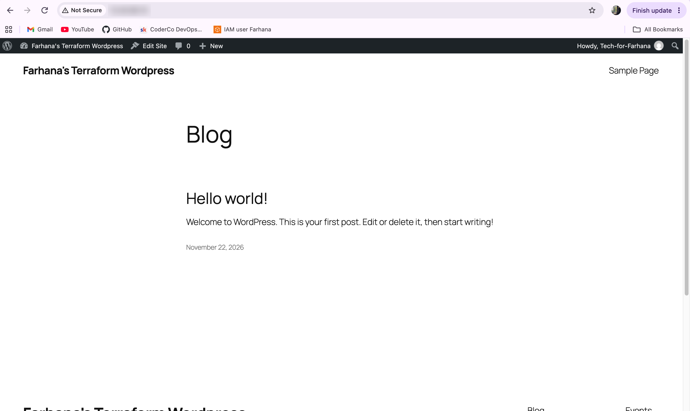

---

## Contents

- [What the assignment asked for](#what-the-assignment-asked-for)
- [Architecture](#architecture)
- [Tech stack](#tech-stack)
- [Project structure](#project-structure)
- [Step-by-step: how I built it](#step-by-step-how-i-built-it)
- [Security decisions](#security-decisions)
- [Challenges I hit and how I fixed them](#challenges-i-hit-and-how-i-fixed-them)
- [How to run it yourself](#how-to-run-it-yourself)
- [What I learnt](#what-i-learnt)
- [Future improvements](#future-improvements)

---

## What the assignment asked for

| Requirement | How I met it |
|---|---|
| EC2 instance running WordPress | `aws_instance` running Ubuntu 24.04 with Apache, MySQL and PHP |
| Security groups | `aws_security_group`, with separate ingress/egress rule resources |
| User data / cloud-init to install dependencies | `user_data.sh`, injected with `templatefile()` |
| A working public endpoint | Public IP, plus a `wordpress_url` output |
| All resources provisioned via Terraform | 6 resources and 1 data source, with nothing created by hand |
| `main.tf`, `variables.tf`, `outputs.tf` | ✅ |
| Screenshots of the working site | In [`screenshots/`](screenshots/) |

---

## Architecture

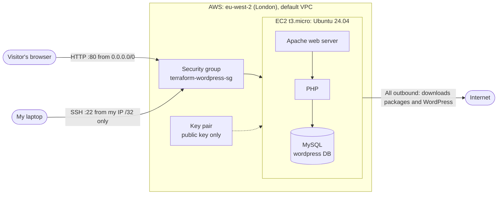

**How a page loads:** the browser sends a request to port 80 → the security group allows it → Apache receives it → PHP runs the WordPress code → PHP fetches the content from MySQL → Apache sends the finished HTML back.

---

## Tech stack

| Tool | Purpose |
|---|---|
| **Terraform 1.17** | Infrastructure as Code |
| **AWS provider `~> 6.0`** | Lets Terraform talk to AWS (v6.73.0 installed) |
| **AWS EC2** (`t3.micro`, free-tier eligible) | The server |
| **Ubuntu 24.04 LTS** | Operating system, with 5 years of security updates |
| **Apache, MySQL, PHP** | The software WordPress needs |
| **cloud-init / user data** | Runs the install script automatically on first boot |
| **AWS CLI v2 + `aws login`** | Authentication with temporary credentials, no access keys |

---

## Project structure

```
Terraform-wordpress/
├── main.tf               # Provider, AMI lookup, security group, key pair, EC2 instance
├── variables.tf          # All inputs (region, instance type, DB settings, my IP…)
├── outputs.tf            # Instance ID, public IP/DNS, WordPress URL, SSH command
├── user_data.sh          # Boot script that installs and configures WordPress
├── .gitignore            # Keeps state, secrets, plugins and keys out of Git
├── .terraform.lock.hcl   # Locks exact provider versions (committed on purpose)
├── screenshots/          # Evidence
└── README.md
```

Files that exist locally but are **deliberately not in this repo**: `terraform.tfvars` (my IP and the database password), `terraform.tfstate` (contains the password in plain text) and `.terraform/` (downloaded provider plugins).

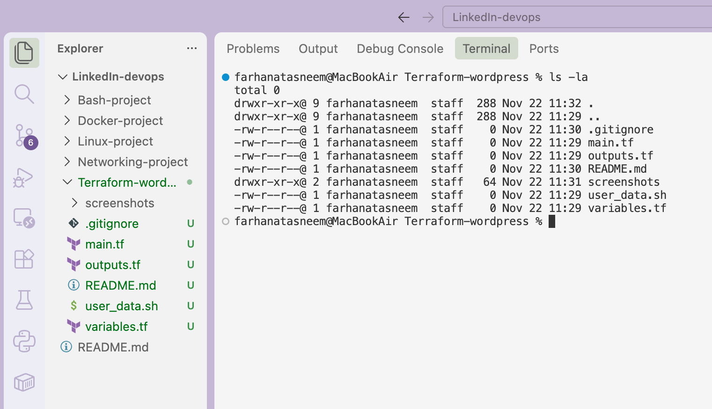

---

## Step-by-step: how I built it

### Step 1: Prerequisites

- **Terraform**: my version was out of date. My Intel Mac doesn't use Homebrew, and it turned out Terraform had been installed with **MacPorts**, so I upgraded it with `sudo port selfupdate` and `sudo port upgrade terraform-1.17`.
- **AWS CLI v2**, authenticated with **`aws login`**: a browser-based sign-in that gives the CLI **temporary credentials**. There are no long-term access keys anywhere on my machine or in this code.
- **An IAM user, not root.** I protected the root user with MFA, created a `devops-learning` IAM group, and created an IAM user `farhana-devops` (also with MFA) for all day-to-day work.

```bash
aws sts get-caller-identity   # Arn ends in :user/farhana-devops, not :root
```

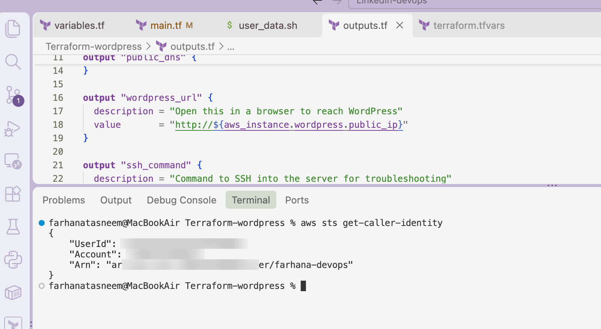

**Region:** `eu-west-2` (London), the closest region to me.

---

### Step 2: Project structure and `.gitignore` first

I created the folder, the empty files and the `.gitignore` **before running any Terraform command**. `terraform init` and `apply` create files that must never be committed, so the protection had to be in place first.

I started from GitHub's official [Terraform `.gitignore` template](https://github.com/github/gitignore/blob/main/Terraform.gitignore) and added three rules for this project:

| Rule | Why |
|---|---|
| `*tfplan*` | Saved plan files contain variable values, including secrets |
| `.DS_Store` | macOS Finder metadata |
| `*.pem` | Safety net for private SSH keys |

Two important points I learnt from the template:
- **`*.tfstate` is ignored** because state stores values, including passwords, **in plain text**.
- **`.terraform.lock.hcl` is *not* ignored.** It records exact provider versions and checksums, so it must be committed for reproducible runs. (Not to be confused with `.terraform.tfstate.lock.info`, a temporary lock file that *is* ignored.)

---

### Step 3: Provider configuration

```hcl
terraform {
  required_providers {
    aws = {
      source  = "hashicorp/aws"
      version = "~> 6.0"
    }
  }
}

provider "aws" {
  region = var.aws_region
}
```

- **`~> 6.0`** allows any 6.x release (bug fixes and new features) but **blocks 7.0**, so a future major version with breaking changes can't be installed automatically. `terraform init` chose **v6.73.0**, signed by HashiCorp.
- **No credentials in the provider block.** The provider picks up the `aws login` session automatically.

```bash
terraform init      # downloads the provider, creates .terraform.lock.hcl
terraform fmt       # standard formatting
terraform validate  # checks syntax and references
```

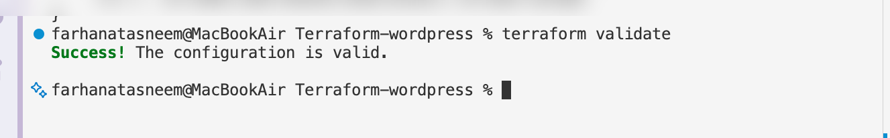

---

### Step 4: Variables

Every value that could change between deployments is an input in `variables.tf`:

| Variable | Default | Notes |
|---|---|---|
| `aws_region` | `eu-west-2` | |
| `instance_type` | `t3.micro` | Free-tier eligible |
| `project_name` | `terraform-wordpress` | Used to name and tag resources |
| `my_ip` | **none** | My IP in CIDR form (`x.x.x.x/32`) for SSH |
| `db_name` | `wordpress` | |
| `db_user` | `wpuser` | |
| `db_password` | **none** | Marked `sensitive = true` |
| `public_key_path` | `~/.ssh/terraform-wordpress.pub` | |

**Declarations vs values:** `variables.tf` *declares* the variables and is committed. The real values for `my_ip` and `db_password` live in `terraform.tfvars`, which Terraform loads automatically and **Git ignores**.

**What `sensitive = true` does, and doesn't do:** it replaces the value with `(sensitive value)` in `plan` and `apply` output, including anything built from it. That's why the whole `user_data` script is hidden in the plan. It does **not** keep the value out of the state file. The two layers work together: `sensitive` protects terminal output and screenshots, and `.gitignore` protects the state file.

---

### Step 5: Finding the AMI with a data source

Instead of hard-coding an AMI ID, Terraform **looks up** the latest official Ubuntu 24.04 image:

```hcl
data "aws_ami" "ubuntu" {
  most_recent = true
  owners      = ["099720109477"] # Canonical

  filter {
    name   = "name"
    values = ["ubuntu/images/hvm-ssd-gp3/ubuntu-noble-24.04-amd64-server-*"]
  }
  # + filters for root-device-type = ebs and virtualization-type = hvm
}
```

**Why not hard-code it?** AMI IDs are **different in every region** and go out of date as new patched images are published. I saw this first-hand: the same lookup returned different IDs in Stockholm and London.

**Why `owners` matters:** anyone can publish a public AMI with "ubuntu" in its name. Restricting to Canonical's account ID means only **genuine** Ubuntu images can be used.

**`most_recent = true`:** the wildcard `*` matches every dated version, and this picks the newest one, which has the latest security patches.

---

### Step 6: Security group

One security group, plus **one resource per rule**: the approach the current AWS provider docs recommend over inline `ingress {}` and `egress {}` blocks.

| Rule | Port | Source | Why |
|---|---|---|---|
| Ingress: HTTP | 80 | `0.0.0.0/0` | The website must be public |
| Ingress: SSH | 22 | `var.my_ip` (`/32`) | Admin access for me only |
| Egress: all | all (`-1`) | `0.0.0.0/0` | The server must download packages and WordPress |

- **SSH is restricted** because it gives control of the server, and bots constantly scan the internet for open port 22. With a `/32`, nobody else can even reach the port.
- **The egress rule must be explicit:** AWS normally adds an "allow all outbound" rule, but **Terraform removes it**. Without my egress rule, the boot script couldn't download anything.

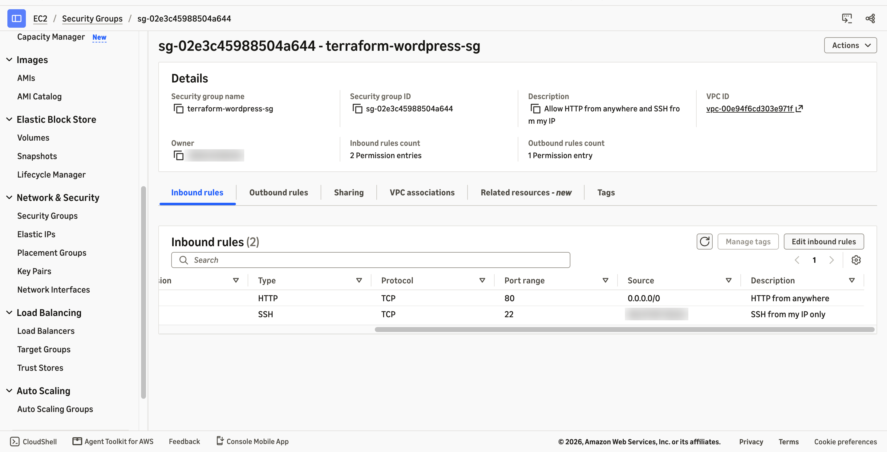

---

### Step 7: SSH key pair

I generated the key **locally** and gave Terraform only the **public** half:

```bash
ssh-keygen -t ed25519 -f ~/.ssh/terraform-wordpress -C "terraform-wordpress"
```

```hcl
resource "aws_key_pair" "wordpress_key" {
  key_name   = "${var.project_name}-key"
  public_key = file(pathexpand(var.public_key_path))
}
```

- `pathexpand()` turns `~` into my full home path, because `file()` doesn't understand `~` on its own, and `file()` then reads the key's contents.
- **Why not let Terraform generate the key** (`tls_private_key`)? Because the **private key would then be stored in plain text in the state file**. This way, it never leaves my laptop.

---

### Step 8: The user data script

`user_data.sh` runs **once, as root, on first boot** through cloud-init. It turns a blank Ubuntu server into a working WordPress site:

1. **`set -euo pipefail`**: stop at the first error. Without it, a failed install would be hidden and the script would carry on, leaving a broken site and no obvious cause.
2. **Install** Apache, MySQL, PHP, `libapache2-mod-php` (lets Apache run PHP), `php-mysql` (lets PHP talk to MySQL) and the PHP extensions WordPress uses
3. **Create the database and user.** The user can only connect from `localhost`, and only has permissions on its **own** database (least privilege). No MySQL root password is needed, because Ubuntu's MySQL trusts the Linux root user through socket authentication.
4. **Download WordPress** into Apache's web root (`/var/www/html`) and remove Apache's default page
5. **Configure `wp-config.php`** with `sed`, replacing the sample file's placeholders with the real database details
6. **Give ownership to `www-data`** (the user Apache runs as) and restart Apache

**How the values get in:** `templatefile()` replaces `${db_name}`, `${db_user}` and `${db_password}` with my variables. One gotcha: in a template, **every `${}` belongs to Terraform**, so a normal Bash variable would need to be written as `$${var}`.

I checked the syntax with `bash -n user_data.sh` before deploying.

---

### Step 9: The EC2 instance

The resource that brings everything together:

```hcl
resource "aws_instance" "wordpress" {
  ami                         = data.aws_ami.ubuntu.id
  instance_type               = var.instance_type
  key_name                    = aws_key_pair.wordpress_key.key_name
  vpc_security_group_ids      = [aws_security_group.wordpress_sg.id]
  associate_public_ip_address = true

  user_data = templatefile("${path.module}/user_data.sh", {
    db_name     = var.db_name
    db_user     = var.db_user
    db_password = var.db_password
  })
  user_data_replace_on_change = true

  root_block_device {
    volume_type = "gp3"
    volume_size = 8
    encrypted   = true
  }

  metadata_options {
    http_tokens = "required" # IMDSv2
  }

  tags = { Name = "${var.project_name}-server" }
}
```

- **`user_data_replace_on_change = true`:** user data only runs on first boot, so if the script changes, the instance is **replaced**. Otherwise a fix would silently never take effect.
- **`encrypted = true`:** the disk is encrypted at rest.
- **IMDSv2 (`http_tokens = "required"`):** protects the instance metadata service, which can hand out credentials, from a common attack where a vulnerable web app is tricked into reading it.
- **Implicit dependencies:** because the instance references the security group and key pair, Terraform knows to create those **first**. No manual ordering is needed.

---

### Step 10: Outputs

`outputs.tf` prints everything I need after `apply`: `instance_id`, `public_ip`, `public_dns`, a clickable `wordpress_url` (`http://<ip>`) and a ready-to-copy `ssh_command`.

---

### Step 11: Apply

```bash
terraform plan    # Plan: 6 to add, 0 to change, 0 to destroy
terraform apply
```

Before applying, I read the plan carefully and spotted a typo in the security group description. I fixed it **before** applying, because a security group's description can't be changed after creation: fixing it later would have forced Terraform to **destroy and recreate** the security group.

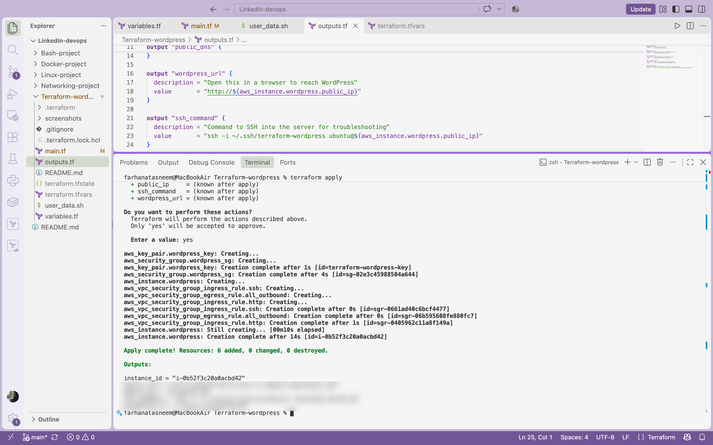

Terraform finished in under 30 seconds, but **"Apply complete" only means the instance exists**. The user data script then took a few more minutes to install everything inside the server.

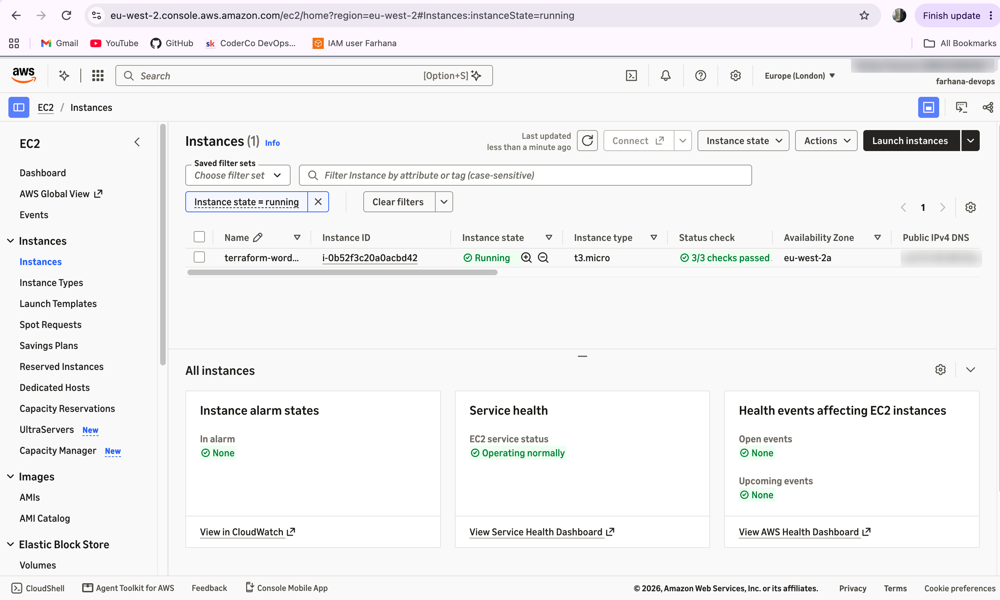
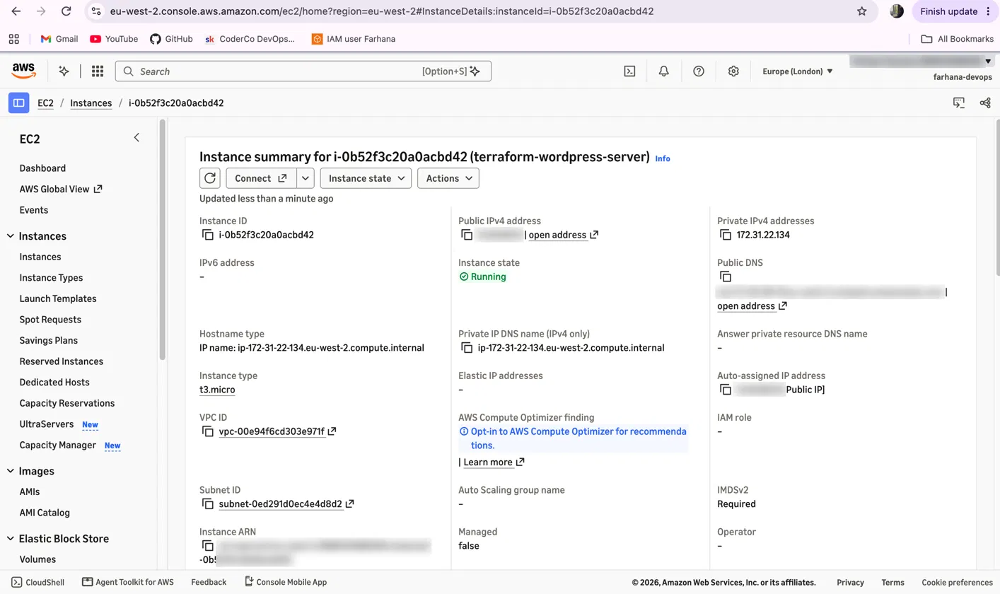
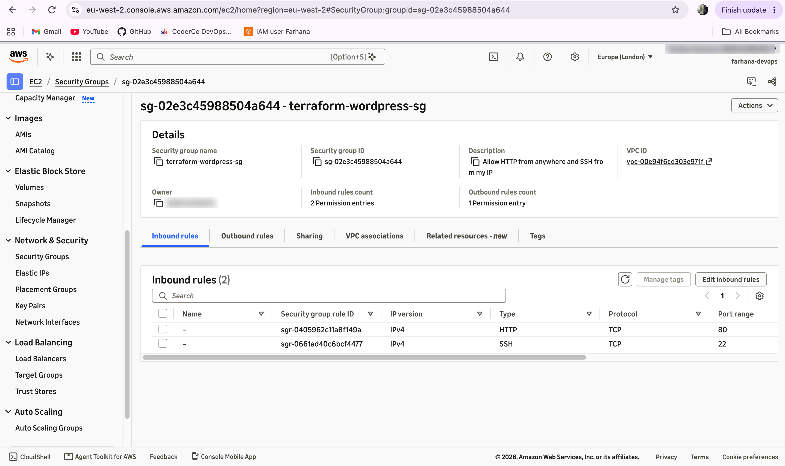

---

### Step 12: Testing WordPress

Visiting `http://<public-ip>` showed the WordPress setup screen. Reaching it at all proved the **database connection worked**, because WordPress only gets that far if `wp-config.php` and MySQL are set up correctly. I completed the setup (avoiding the username `admin`, which attackers guess first) and logged in.

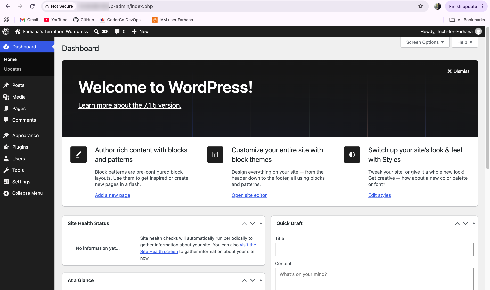


*The site uses plain HTTP, so the browser shows "Not Secure". HTTPS is listed under future improvements.*

---

### Step 13: Destroy

```bash
terraform destroy   # Plan: 0 to add, 0 to change, 6 to destroy
```

Terraform removed everything in **reverse dependency order**: the security group rules and the instance first, then the key pair and the security group. Because `delete_on_termination` is `true`, the disk was removed too, so no orphaned resources are left costing money.

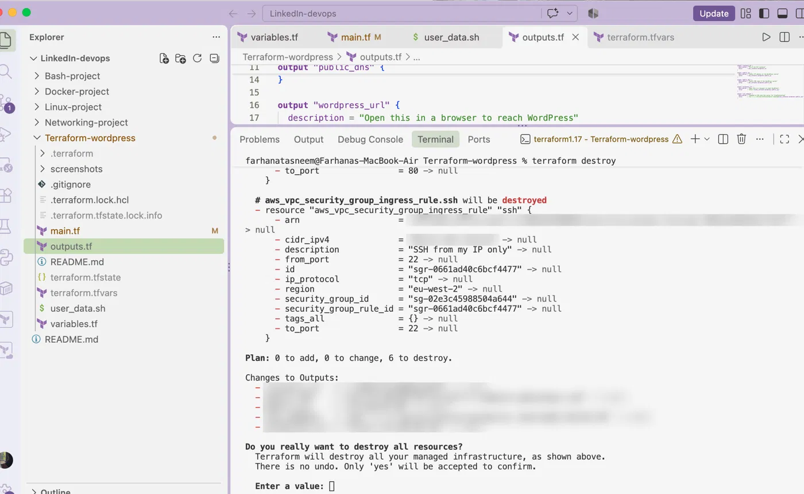
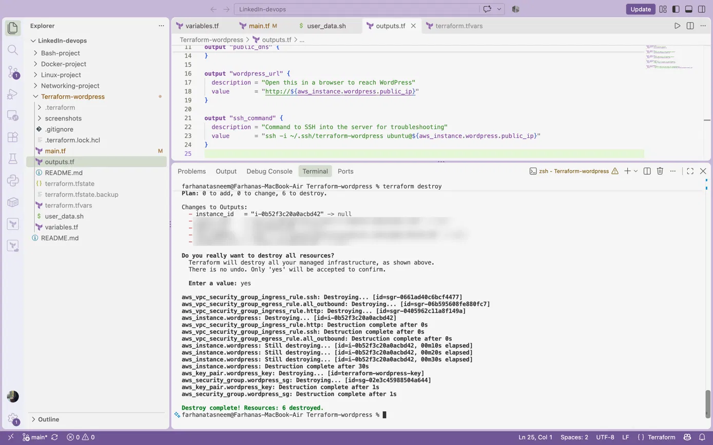

The code is unchanged, so the whole stack can be rebuilt identically at any time with `terraform apply`.

---

## Security decisions

| Decision | Risk it addresses |
|---|---|
| IAM user with MFA; root locked away with MFA | A compromised root account = total account takeover |
| `aws login` temporary credentials, **no access keys** | Leaked long-term keys work until someone revokes them |
| SSH limited to my IP (`/32`) | Automated SSH brute-force attacks |
| AMI restricted to Canonical's owner ID | Malicious look-alike AMIs |
| SSH key generated locally; only the public key uploaded | Private key exposure via Terraform state |
| `sensitive = true` on the DB password | Password appearing in terminal output and screenshots |
| `terraform.tfvars`, `*.tfstate`, `*tfplan*`, `*.pem` git-ignored | Secrets being pushed to a public repo |
| MySQL user restricted to `localhost` and its own database | Least privilege inside the server |
| Encrypted EBS root volume | Data exposure at rest |
| IMDSv2 required | Credential theft via the metadata service (SSRF) |
| Screenshots blurred (IPs, account ID) | Leaking identifying details publicly |

**A note on permissions:** my `devops-learning` IAM group has `AdministratorAccess`, a deliberate choice for a personal learning account where I'm the only user, protected by MFA and with no access keys. In a team or production setting, I would use **least-privilege** policies instead.

---

## Challenges I hit and how I fixed them

| # | Problem | Cause | Fix |
|---|---|---|---|
| 1 | Terraform showed an "out of date" warning | Old version; no Homebrew on my Intel Mac | `which terraform` showed `/opt/local/bin`, meaning it was installed via **MacPorts**. Upgraded with `sudo port selfupdate` + `sudo port upgrade terraform-1.17`. |
| 2 | `touch screenshots/` → "No such file or directory" | `touch` creates files, not folders | Used `mkdir` for the folder |
| 3 | Created `output.tf` | Typo | Renamed to `outputs.tf` to match the brief and convention |
| 4 | Moving the project into my portfolio repo | The project had its own `.git`, so Git would see a repo inside a repo | Removed the inner `.git` before moving |
| 5 | `git status` showed `terraform-wordpress` **and** `Terraform-wordpress` | macOS ignores capital letters in names, Git doesn't | Two-step rename via a temporary name with `git mv` |
| 6 | Files showed with a strike-through in VS Code | VS Code was still pointing at the old folder location | Reopened the folder from its new path |
| 7 | Login failed: region not supported | My first AWS account was restricted to `eu-north-1` | Switched the CLI and the Terraform default region |
| 8 | `aws login` kept failing with `ValidationException` | A problem with that account and its login session | Set up a fresh AWS account: MFA on root, an IAM group and IAM user, and `aws logout` / `aws login` as the IAM user |
| 9 | "Unexpected attribute: my_ip" in `terraform.tfvars` | `variables.tf` wasn't **saved**, and I'd put quotes around the variable name | Saved the file (and turned on Auto Save); removed the quotes, because names are bare and only values are quoted |
| 10 | `terraform plan` → "No configuration files" | Ran it from the wrong folder | `cd` into the project folder; I now check the prompt first |
| 11 | The AMI ID from the CLI didn't match Terraform's | I'd copied an older image from the unsorted CLI list | Terraform's `most_recent = true` correctly picks the newest |
| 12 | `plan` → "No valid credential sources found" | The `aws login` session had expired | `aws logout`, then `aws login` again |
| 13 | Typo in the security group description | Missing space | Fixed **before** apply, since descriptions can't be edited and a later change would force replacement |
| 14 | SSH → "Connection closed by … port 22" | The security group worked (the connection was reached), but authentication was closed. Likely the SSH agent offered too many keys. | Next time: `ssh -o IdentitiesOnly=yes -i <key> ubuntu@<ip>` |

---

## How to run it yourself

**Requirements:** Terraform ≥ 1.5, AWS CLI v2, and an AWS account with an IAM user.

```bash
# 1. Authenticate
aws login --region eu-west-2

# 2. Create an SSH key
ssh-keygen -t ed25519 -f ~/.ssh/terraform-wordpress -C "terraform-wordpress"

# 3. Create terraform.tfvars (never commit this file)
cat > terraform.tfvars <<EOF
my_ip       = "$(curl -s https://checkip.amazonaws.com)/32"
db_password = "ChangeMeLettersAndNumbers123"
EOF

# 4. Deploy
terraform init
terraform plan
terraform apply

# 5. Wait ~5 minutes, then open the wordpress_url output (http://, not https://)

# 6. Clean up
terraform destroy
```

> Use only letters and numbers in `db_password`, because characters like `/`, `&` or quotes would break the `sed` commands in `user_data.sh`.

---

## What I learnt

- **Infrastructure as Code** makes infrastructure repeatable, reviewable and disposable: I can destroy everything and rebuild an identical stack in minutes.
- **Always read the plan.** It's where I caught a change that would have forced a resource replacement.
- **`init` → `fmt` → `validate` → `plan` → `apply` → `destroy`** and what each one actually does
- **`resource` vs `data`:** creating something vs looking up something that already exists
- **Implicit dependencies:** Terraform works out the order from references
- **State is sensitive.** `sensitive = true` hides values on screen, not in state.
- **Fail fast** in scripts with `set -euo pipefail`
- **Least privilege** applies everywhere: IAM, the network (security group rules) and the database user
- Plenty of real-world troubleshooting: version management, Git, regions, credentials and SSH

